```bash
$ whoami
vqvinh

$ cat profile.json
{
  "role": "Software Engineer",
  "domains": [
    "Backend Systems",
    "Distributed Infrastructure",
    "Cloud Services"
  ],
  "stack": {
    "languages": ["C++", "TypeScript", "Python", "SQL"],
    "infrastructure": ["Docker", "Linux", "Cloudflare Workers", "PostgreSQL"],
    "tools": ["Git", "GitHub Actions", "Redis"]
  },
  "current_focus": "High-throughput APIs and low-latency data processing"
}
```

<!-- AWAKEN:START -->
<!-- Generated by git-profile-awaken. Edit awaken.json instead of this block. -->
<p align="center">
<picture><source media="(prefers-color-scheme: dark)" srcset="awaken/hunter-dark.svg"><source media="(prefers-color-scheme: light)" srcset="awaken/hunter-light.svg"></picture>
</p>

<p align="center">
<picture><source media="(prefers-color-scheme: dark)" srcset="awaken/ladder-dark.svg"><source media="(prefers-color-scheme: light)" srcset="awaken/ladder-light.svg"></picture>
</p>

<p align="center">
<picture><source media="(prefers-color-scheme: dark)" srcset="awaken/web-dark.svg"><source media="(prefers-color-scheme: light)" srcset="awaken/web-light.svg"></picture>
<picture><source media="(prefers-color-scheme: dark)" srcset="awaken/skills-dark.svg"><source media="(prefers-color-scheme: light)" srcset="awaken/skills-light.svg"></picture>
</p>

<p align="center">
<picture><source media="(prefers-color-scheme: dark)" srcset="awaken/activity-dark.svg"><source media="(prefers-color-scheme: light)" srcset="awaken/activity-light.svg"></picture>
</p>

<p align="center">
<picture><source media="(prefers-color-scheme: dark)" srcset="awaken/quest-dark.svg"><source media="(prefers-color-scheme: light)" srcset="awaken/quest-light.svg"></picture>
<picture><source media="(prefers-color-scheme: dark)" srcset="awaken/contribution-dark.svg"><source media="(prefers-color-scheme: light)" srcset="awaken/contribution-light.svg"></picture>
</p>

<p align="center">
<picture><source media="(prefers-color-scheme: dark)" srcset="awaken/oracle-dark.svg"><source media="(prefers-color-scheme: light)" srcset="awaken/oracle-light.svg"></picture>
<picture><source media="(prefers-color-scheme: dark)" srcset="awaken/daily-dark.svg"><source media="(prefers-color-scheme: light)" srcset="awaken/daily-light.svg"></picture>
</p>

<p align="center">
<picture><source media="(prefers-color-scheme: dark)" srcset="awaken/rune-str-dark.svg"><source media="(prefers-color-scheme: light)" srcset="awaken/rune-str-light.svg"></picture>
<picture><source media="(prefers-color-scheme: dark)" srcset="awaken/rune-agi-dark.svg"><source media="(prefers-color-scheme: light)" srcset="awaken/rune-agi-light.svg"></picture>
<picture><source media="(prefers-color-scheme: dark)" srcset="awaken/rune-int-dark.svg"><source media="(prefers-color-scheme: light)" srcset="awaken/rune-int-light.svg"></picture>
<picture><source media="(prefers-color-scheme: dark)" srcset="awaken/rune-vit-dark.svg"><source media="(prefers-color-scheme: light)" srcset="awaken/rune-vit-light.svg"></picture>
</p>

<p align="center">
<picture><source media="(prefers-color-scheme: dark)" srcset="awaken/rune-luk-dark.svg"><source media="(prefers-color-scheme: light)" srcset="awaken/rune-luk-light.svg"></picture>
<picture><source media="(prefers-color-scheme: dark)" srcset="awaken/rune-cha-dark.svg"><source media="(prefers-color-scheme: light)" srcset="awaken/rune-cha-light.svg"></picture>
</p>
<!-- AWAKEN:END -->

---

### Tech Stack


---

### Selected Projects

| Project | Description | Tech Stack | Status |
| :--- | :--- | :--- | :--- |
| `discord-cloudflare-bot` | Edge-deployed automated service running on serverless workers. | `TypeScript`, `Cloudflare D1`, `SQL` | Active |
| `core-service-engine` | High-efficiency processing engine and networking utility. | `C++`, `POSIX Sockets` | Maintained |

---

### Contact & Collaboration

```bash
$ curl -s https://api.vqvinh.dev/contact
```

- **LinkedIn:** [linkedin.com/in/vqvinh22](https://www.linkedin.com/in/vqvinh22)
- **Email:** [vqvinh22@gmail.com](mailto:vqvinh22@gmail.com)

For inquiries regarding backend architecture, distributed systems, or collaborative engineering initiatives, connect via LinkedIn or initiate discussion via email.
